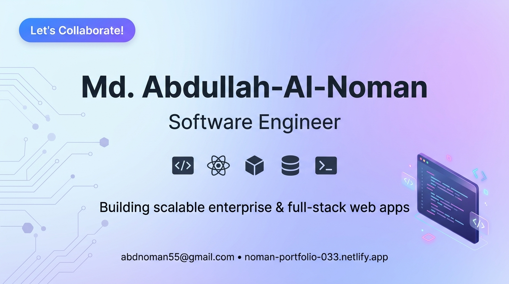

<!--- banner --->

  

 

<!--- title --->

  <h1>Hi 👋, I'm Md. Abdullah-Al-Noman</h1>
  

 

<!--- about --->
##  <b>ABOUT ME:</b>

- 👋 Hi, I'm **[@Noman599033](https://github.com/Noman599033)** based in **Dhaka, Bangladesh**
- 💼 Currently working with **3+ years of professional experience** on enterprise **Laravel**, **Javascript**, **RESTful APIs**, and **MSSQL** architectures
- 🔭 Currently exploring **Next.js, TypeScript, and Docker** while building modern full-stack web applications
- 🛠️ Experienced with **Laravel (v6/10/12), React.js, Vue.js, Node.js, Express.js, MSSQL, MySQL, and MongoDB**
- 🌱 Recently built **[GariBondhu](https://github.com/Noman599033/GariBondhu)** (Laravel 12 + Vue 3 car rental platform), **[BDCrops](https://github.com/Noman599033/bdcrops)** (PHP e-commerce), and **[World Cup Football](https://github.com/Noman599033/world_cup_football)** (React + TypeScript)
- 💬 Ask me about **Laravel Architecture, RESTful APIs, MSSQL Query Optimization, and Full-Stack Web Development**
- 🌐 Explore my **[Portfolio](https://noman-portfolio-033.netlify.app/)**
- 📫 Feel free to reach me at **[abdnoman55@gmail.com](mailto:abdnoman55@gmail.com)**

 

<!--- socials --->
##  <b>FOLLOW ME ON SOCIALS:</b>

  
  
  
  

 

<!--- technology --->
##  <b>TECHNOLOGY STACK:</b>

### Languages:

### Frontend & CSS Frameworks:

### Backend & Frameworks:

### Databases:

  
  

### Deployment & Hosting:

### Design & Graphics:

### Tools & Platforms:

 

<!--- statistics --->
##  <b>GITHUB STATISTICS & ANALYSIS:</b>

### GitHub Contributions:

  <picture>
    <source media="(prefers-color-scheme: dark)" srcset="https://raw.githubusercontent.com/Noman599033/Noman599033/output/github-contribution-grid-snake-dark.svg" />
    <source media="(prefers-color-scheme: light)" srcset="https://raw.githubusercontent.com/Noman599033/Noman599033/output/github-contribution-grid-snake.svg" />
    
  </picture>

### GitHub Statistics:
|  |  |
| :---: | :---: |

### Profile Summary & Streak:
|  |  |
| :---: | :---: |

 

<!--- random quote --->
##  <b>RANDOM DEV QUOTE:</b>

  

---

<!--- visit count --->

  

